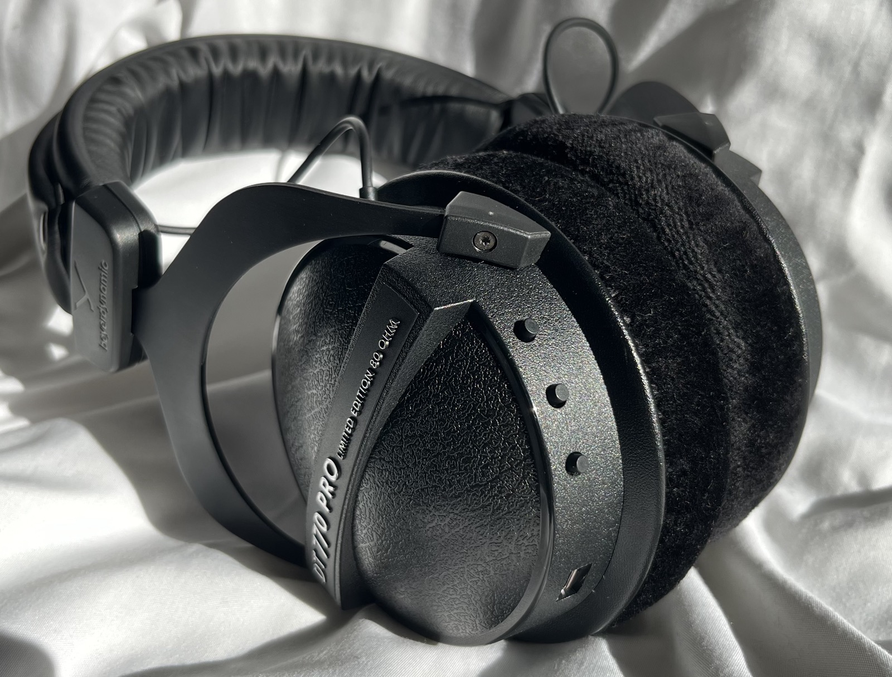
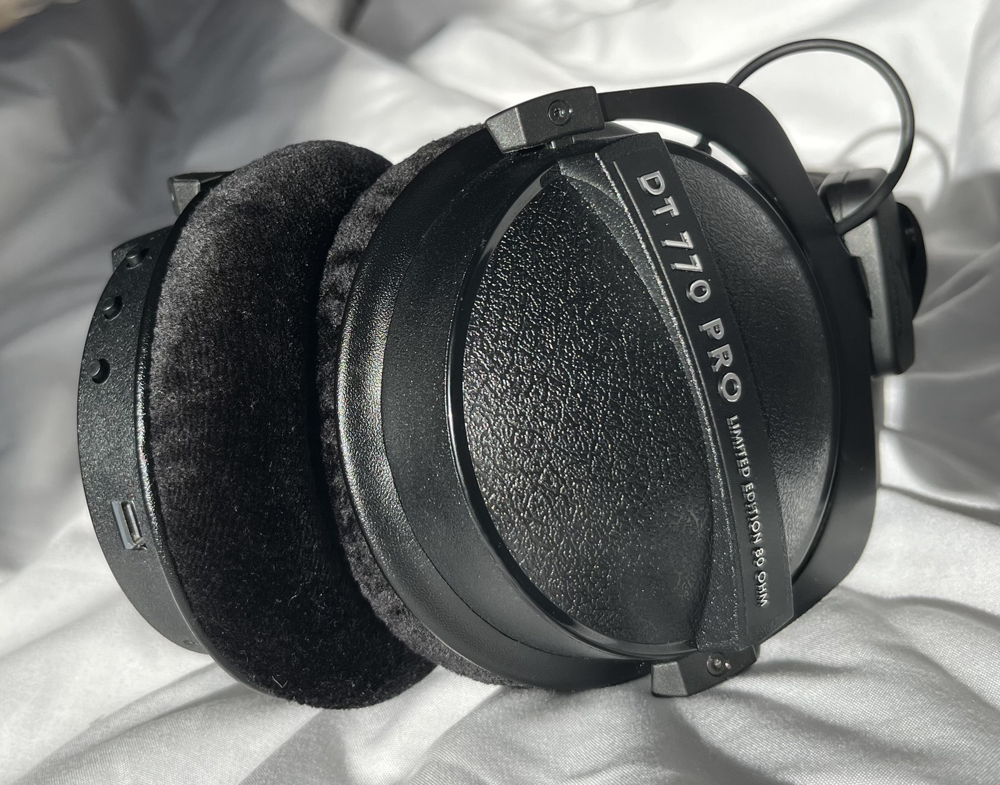
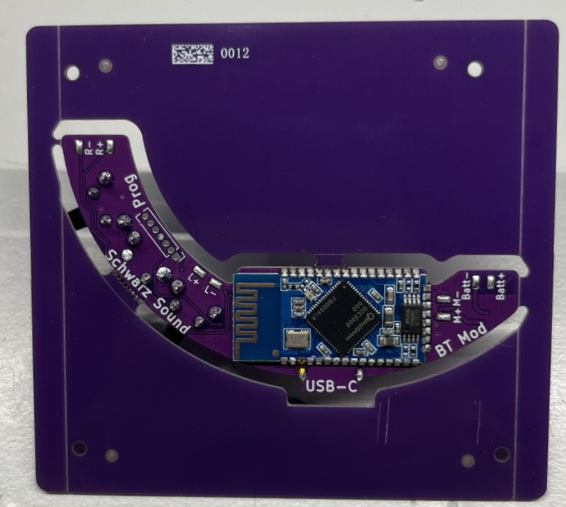
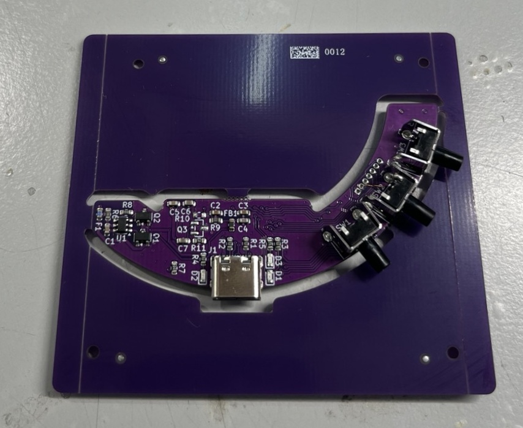

This modification adds Bluetooth, USB-C charging and Audio support to DT-770 Pro Headsets from beyerdynamic.
======

A DIY hardware modification for Beyerdynamic headphones.

This project provides everything needed to build the modification yourself, including the PCB design, firmware configuration files, 3D-printable parts and a complete assembly guide.
The project is designed to be relatively easy to build. No specialized equipment is required, but basic soldering and mechanical skills are necessary.

This modification turns the DT-770 Pro into a fully featured Bluetooth headset, built around the BTM308 module (Qualcomm QCC3008). It supports SBC, AAC, aptX and aptX Low Latency, includes a microphone back channel, AVRCP controls. (Play/Pause/Vol+/Vol-/Fwrd/Back)

It works with two devices at the same time (multipoint). 
On power-up it reconnects to the two most recently used devices, and a second device can join at any time. If one device pauses and the other starts playing, the switch takes less than a second. Calls and microphone use (Windows, WhatsApp, Siri) always take priority over music.

A log Volume curve is used (−56 dB to 0 dB) making low as well as high volume listing enjoyable. 
After a pause the audio connection stays open for 30 seconds, so music resumes without delay. The battery level is reported in 1 % steps on iPhone, Android and Windows. The headphones switch off automatically after 15 minutes of silence with a connected device (5 minutes without a connection), but never during music, a call or USB. Prompts are either simple tones or spoken announcements, depending on the profile.

Connected to a PC via USB, the headphones act as a USB sound card and Bluetooth is switched off. When the PC goes to sleep or the cable is unplugged, Bluetooth comes back and reconnects. On a plain charger they only charge and Bluetooth stays on. 

A RGB LED shows the state: 
- connected (Green fading) 
- playing (Green fading fast) 
- waiting for pairing (Blue flashing)
- charging (red solid)
- full (Green solid)
- low battery (Red flashing)
- USB (Blue solid).

The assembly guide can be found in the documentation folder.

## Why the full firmware is not included

The firmware is based on Qualcomm ADK The ADK source code is "Confidential and Proprietary" therefore i can't redistribute it, so neither the source code nor a finished firmware file can be published here.

## Minimal configuration (works without building anything)

If you don't have the ADK, you can still get most of the way there. The repository includes a minimal configuration that works out of the box and provides almost all of the features above.

It comes with known bugs:

- **No battery level.** The battery percentage is not shown on your phone or PC.
- **Delay after pause.** When you pause and resume, the music starts again after a 1s delay, because the audio connection is not kept open. (really annoying while skipping in videos)
- **Delay switching Multipoint.** Switching connected devices takes a while.
- **LED inconsistency** LED state display sometimes buggy because original firmware does not reset timers right.

### Disclaimer

This project is an independent modification for Beyerdynamic headphones and is not affiliated with, endorsed by, or sponsored by Beyerdynamic
This project involves modification of electronic equipment. The author provides the hardware designs, firmware and documentation "AS IS", without warranty of any kind.
The author assumes no responsibility for damage to headphones, batteries, electronic components, personal property or persons resulting from the use, modification, manufacture or installation of this project.
Use and modification of the project is entirely at the your own risk.

### License

This project is available for personal and non-commercial use.
You are free to study, build and modify the project for your own personal use.
Commercial manufacture, sale or distribution of the project or derivatives is not permitted without explicit permission from the author.

Have fun building!
